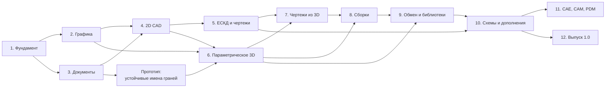

# План разработки

Результат 7 из раздела 14 исходного ТЗ: этапы, зависимости между ними и критерии готовности.

Сроков здесь нет намеренно. Исходное ТЗ запрещает обещать сроки без оценки команды
и трудозатрат, а состав команды неизвестен. Вместо сроков у каждого этапа — проверяемое
условие «готово».

## Где мы сейчас

| Этап | Название | Состояние |
| --- | --- | --- |
| 1 | Архитектура и фундамент | **Готов**, кроме проверки сборки под Windows |
| 2 | Графическая подсистема | **Частично**: 2D и 3D показываются; 3D рисуется программно, отрисовки на видеокарте нет |
| 3 | Документная модель | **Готов** |
| 4 | Базовый 2D CAD | **Большей частью**: простую деталь уже можно начертить и оформить; нет сплайнов и эллипсов |
| 5 | ЕСКД и чертежи | **Частично**: механизм и основная надпись готовы, покрытие стандартов малое |
| 6 | Параметрическое 3D | **Большей частью**: ядро, формулы, дерево построения, перестроение, окно 3D; нет решателя ограничений эскиза |
| 7 | Чертежи из 3D | **Частично**: основные виды с невидимыми линиями и обновление по команде; есть простой разрез; нет сечений, сложных разрезов и привязки размеров к рёбрам |
| 8 | Сборки | **Частично**: компоненты и подсборки, шесть сопряжений, пересечения, зазор, состав изделия; нет степеней свободы |
| 9 | Обмен и библиотеки | **Частично**: DXF, SVG, STEP, STL, CSV; библиотека крепежа (болты, гайки, шайбы) |
| 10 | Электросхемы и расширения | **Частично**: схемы работают (элементы, проводники, цепи, перечень, проверка), но в наборе обозначений два элемента; дополнений нет |
| 11 | CAE, CAM, PDM | Не начат |
| 12 | Оптимизация и выпуск | Не начат |

Это соответствует версии продукта **0.3** по разделу 13 ТЗ с пробелами, перечисленными в `docs/requirements-status.md`.

## Зависимости между этапами

Главное на схеме — **прототип устойчивых имён граней стоит перед этапом 6**. Это самый
большой технический риск проекта (см. `docs/risks.md`, РЕШ-3). Если начать 3D без этой
проверки, можно написать этап 6 целиком и обнаружить, что модели «ломаются» при каждом
изменении.

## Этапы и критерии готовности

### Этап 1. Архитектура и фундамент

- [x] Репозиторий, сборка CMake и Ninja, наборы настроек сборки
- [x] Базовые типы: номер объекта, ошибки, журнал, события, единицы
- [x] Модульная структура с автоматической проверкой границ
- [x] Автоматическая проверка запрета ИИ
- [x] Минимальное приложение на Qt
- [x] Автоматическая сборка и тесты под Linux — задание описано и повторяет проверенные команды
- [ ] Автоматическая сборка и тесты под Windows — задание описано, **не запускалось**

**Готово, когда:** чистая машина Windows и чистая машина Linux собирают проект одной командой
и все тесты проходят.

### Этап 2. Графическая подсистема

- [x] Окно 2D: масштаб колесом, сдвиг, «показать всё»
- [x] Сцена, отделённая от Qt
- [x] Выбор щелчком; привязки
- [ ] Отрисовка на OpenGL 4.5
- [ ] Окно 3D, камера
- [x] Выбор рамкой
- [x] Сцена не перестраивается заново при каждой перерисовке
- [ ] Быстрый поиск привязки на больших чертежах (пространственный индекс)

**Готово, когда:** чертёж из 100 000 объектов листается не медленнее 30 кадров в секунду
(КАЧ-6). Скорость отрисовки не измерялась; поиск привязки на таком чертеже занимает
40–67 мс на каждое движение мыши, то есть цель пока не достигнута.

### Этап 3. Документная модель

- [x] Проект, документы, объекты, атрибуты, ссылки
- [x] Транзакции, отмена и повтор, журнал
- [x] Сохранение и загрузка, контрольные суммы, миграции, автосохранение

**Готово, когда:** 1000 случайных команд отменяются до исходного состояния; прерванное
сохранение не теряет данные; повреждённый файл не роняет программу. **Выполнено**, тесты есть.

### Этап 4. Базовый 2D CAD

- [x] Отрезок, прямоугольник, окружность, дуга, текст
- [ ] Точка, полилиния, эллипс, сплайн, многоугольник
- [x] Перенос, копия, поворот, отражение, удаление; масштаб — только из кода
- [x] Обрезка отрезков, скругление и фаска между отрезками
- [ ] Удлинение, эквидистанта; обрезка и скругление дуг и окружностей
- [x] Слои и панель слоёв: текущий слой, видимость, перенос на слой
- [ ] Блокировка, цвет и переименование слоя в окне
- [x] Привязки: конец, середина, центр, пересечение, перпендикуляр, ближайшая
- [ ] Привязки: касательная, сетка
- [x] Размеры: линейный, радиуса, диаметра, угловой; допуски и посадки текстом
- [x] Выноски
- [x] Правка созданных элементов через панель свойств
- [x] Печать в масштабе 1:1
- [ ] Размер следует за геометрией
- [x] Штриховка по выбранному замкнутому контуру, с отверстиями
- [ ] Штриховка, следующая за контуром и обходящая текст; обозначения материалов
- [x] Блоки: создание, вставка, переопределение, разбивка
- [x] Обмен DXF в объёме паспорта `docs/exchange/dxf.md`
- [x] Ввод координат, смещений, радиуса и угла с клавиатуры

**Готово, когда:** инженер может начертить и оформить чертёж простой детали (вал, пластина,
кронштейн) без обходных приёмов.

### Этап 5. ЕСКД и чертежи

- [x] Механизм профилей, наследование, пользовательские профили
- [x] Форматы листов, рамка
- [x] Основная надпись по форме 1: сетка граф, подписи, 14 полей — описана в профиле
- [ ] Сверка расположения строк основной надписи с рисунком стандарта
- [ ] Дополнительные графы, формы 2 и 2а
- [x] Типы линий
- [x] Проверка оформления: 9 видов проверок
- [x] Экспорт PDF в масштабе 1:1
- [ ] Перечень обязательных стандартов ЕСКД, утверждённый специалистом
- [ ] Проверки по этому перечню
- [x] Знаки шероховатости (ГОСТ 2.309-73)
- [x] Технические требования над основной надписью (ГОСТ 2.316-2008)
- [ ] Допуски, посадки, базы
- [x] Формат листа, ориентация и основная надпись в окне
- [ ] Выбор профиля стандарта в окне

**Готово, когда:** чертёж, прошедший проверку программой, проходит нормоконтроль у живого
нормоконтролёра по утверждённому перечню стандартов.

### Этап 6. Параметрическое 3D

- [x] Прототип устойчивых имён граней (итог — в `docs/risks.md`, РЕШ-3)
- [x] Адаптер OCCT за `IGeometryKernel`
- [x] Формулы параметров с единицами
- [x] Эскизы из фигур с размерами-формулами
- [ ] Решатель ограничений эскиза (РЕШ-2)
- [x] Дерево построения, перестроение только изменившегося, диагностика
- [x] Выдавливание, вращение, вырез, скругление, фаска
- [x] Массивы в ряд и по кругу; элемент на грани по щелчку; правка размеров эскиза в окне; откат дерева
- [x] Зеркальная копия тела
- [x] Протяжка вдоль траектории с гибами
- [x] Решатель ограничений эскиза (на чертеже): 16 видов ограничений, степени свободы, отказ при противоречии
- [x] Размеры-формулы от параметров детали; эскиз детали следует за контуром чертежа; значки ограничений
- [ ] Концы дуг в ограничениях; все виды ограничений из окна
- [ ] Лофт, оболочка, уклон
- [x] Окно 3D: вращение, выбор граней, параметры, дерево построения

**Готово, когда:** набор эталонных деталей перестраивается после изменения базового эскиза
без потери ссылок; одна и та же модель даёт одинаковый результат на Windows и Linux.
Сейчас: одна эталонная деталь («Опора») перестраивается без потери ссылок на Linux.

### Этап 7. Чертежи из 3D

- [x] Основные виды детали и сборки с линиями невидимого контура
- [x] Обновление видов по команде после изменения модели
- [x] Простой разрез со штриховкой, надписью и обозначением секущей плоскости
- [x] Сечение; перенос секущей плоскости; пометка «не рассекать»; пометка устаревших видов
- [ ] Ступенчатые и местные разрезы, местные виды
- [x] Размеры на виде переезжают за моделью; потерянные привязки помечаются
- [ ] Привязка размеров к рёбрам модели

**Готово, когда:** после изменения модели все размеры эталонных чертежей либо остались
на своих рёбрах, либо явно помечены.

### Этап 8. Сборки

- [x] Компоненты-ссылки на детали
- [x] Сопряжения: совпадение, соосность, параллельность, расстояние
- [x] Подсборки (сборка в сборке), измерение зазора
- [x] Сопряжения «угол» и «касание»
- [x] Число степеней свободы компонента
- [x] Разнесённый вид; исполнения детали
- [ ] Показ оставшихся движений на экране
- [x] Состав изделия (в окне и в CSV), проверка пересечений

**Готово, когда:** эталонная сборка из 1000 деталей открывается не дольше 10 с (КАЧ-6);
спецификация совпадает с ручным подсчётом. Сейчас проверена сборка из двух деталей.

### Этап 9. Обмен и библиотеки

- [ ] STEP, IGES, STL, OBJ, 3MF — каждый с паспортом и набором тестовых файлов
- [x] Библиотека крепежа: болты, гайки, шайбы
- [x] Библиотека материалов; свои материалы, поиск, импорт и экспорт
- [x] Скрипты на Python через пакетный режим (модуль `cosmocad`)
- [x] Дополнения: менеджер, команды, пример; неизвестные объекты сохраняются
- [ ] Остальные стандартные изделия, профили проката; база SQLite; формат-контейнер (версия 2)

### Этап 10. Электросхемы и расширения

- [x] Схемы: элементы, проводники, метки цепей, цепи, обозначения, перечень в CSV, проверка
- [x] Набор из двадцати обозначений по ГОСТ (добавлены тиристор, светодиод, трансформатор); перечень элементов таблицей на листе
- [x] Номера цепей на схеме
- [ ] Остальные обозначения (симметричный тиристор, трёхфазные трансформаторы, переключающий контакт)
- [ ] Система дополнений по схеме 7

### Этап 11. CAE, CAM, PDM

- [ ] Отдельное ТЗ на каждый модуль; подключение через систему дополнений

### Этап 12. Оптимизация и выпуск

- [ ] Замеры производительности в автоматической сборке
- [ ] Установщики, английский перевод, руководство пользователя

## Замечания к исходному плану

1. **Скрипты на Python** есть в списке модулей ТЗ, но не входят ни в один этап. Предлагаю
   этап 10, вместе с дополнениями: обе задачи открывают наружу одни и те же интерфейсы.
2. **Электросхемы** есть в этапе 10, но отсутствуют в версиях раздела 13. Отнесены к 0.9–1.0.
3. **Версии 0.4 и 0.5** в разделе 13 описывают почти одно и то же. Предлагаю: 0.4 — эскизы
   с ограничениями и выдавливание; 0.5 — остальные операции и дерево построения.
4. **Этап 2 стоит раньше этапа 3**, но окну нечего показывать без документа. Фактически они
   делались вместе, и так стоит делать впредь.
