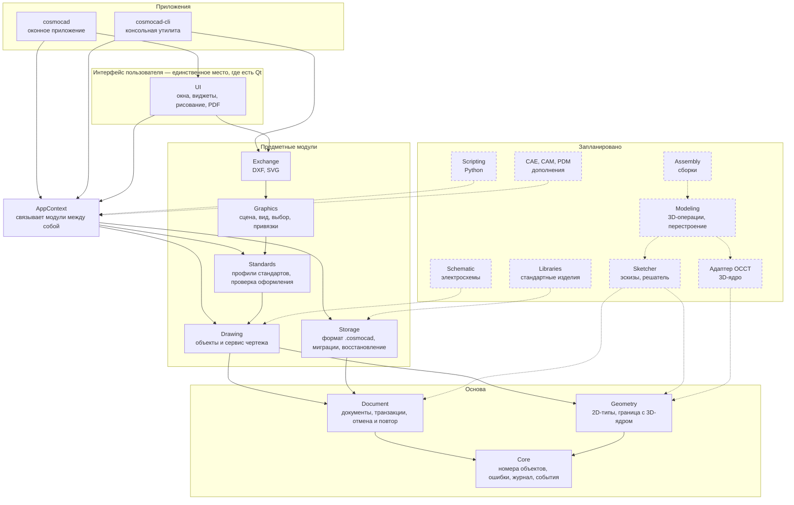

# Схема 1. Из каких частей состоит CosmoCad

Стрелка означает «пользуется». Стрелки идут только вниз: нижние части ничего не знают о верхних.
Сплошная рамка — часть есть в коде (на схеме отмечено состояние версии 0.1; в версии 0.2
добавились Geometry-адаптер OCCT, Modeling и Assembly — см. `docs/architecture/modules.md`). Пунктирная — запланирована, кода ещё нет.

Эта схема соответствует файлам `CMakeLists.txt` и проверяется при каждой сборке
программой `scripts/check_module_boundaries.py`. Если меняется код — меняется и схема.

## Как читать

- **Core** — самые общие вещи: постоянный номер объекта, результат «значение или ошибка», журнал.
- **Document** — документ как набор объектов. Изменить документ можно только через транзакцию,
  поэтому любое действие отменяется целиком.
- **Geometry** — собственные геометрические типы CosmoCad. Здесь же объявлена граница с 3D-ядром;
  само ядро (OCCT) будет подключено за этой границей и больше нигде.
- **Drawing** — линии, окружности, дуги, текст, размеры, слои, лист.
- **Standards** — профиль стандарта (файл с настройками и правилами) и проверка чертежа по нему.
- **Graphics** — превращает документ в список «что нарисовать». Этим списком пользуются экран,
  PDF, SVG и DXF, поэтому чертёж везде выглядит одинаково.
- **Storage** — запись и чтение проекта.
- **UI** — окна. Правил оформления и геометрии в нём нет.
