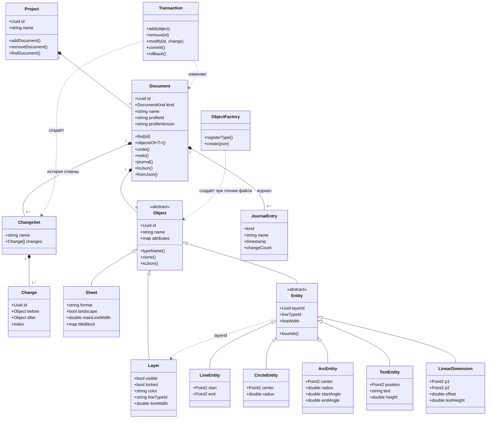

# Схема 2. Модель документа

Что лежит в проекте и как это меняется. Схема соответствует коду в `core/document`,
`core/transactions` и `drawing`.

## Главные правила

1. **У каждого объекта постоянный номер** (`Uuid`). Он не меняется при сохранении, загрузке,
   отмене и повторе.
2. **Слой и лист — такие же объекты**, как линии. Поэтому их изменение отменяется тем же
   механизмом, что и изменение геометрии.
3. **Изменить документ можно только через `Transaction`.** Транзакция запоминает для каждого
   затронутого объекта состояние «до» и «после». Незавершённая транзакция откатывается сама.
4. **Отмена — это применение сохранённых изменений в обратном порядке**, а не «обратная команда».
   Поэтому отмена всегда точна: тест выполняет 1000 случайных команд, отменяет их и сравнивает
   документ с исходным.
5. **Виды документов** перечислены заранее: чертёж, эскиз, деталь, сборка, схема. В версии 0.1
   объекты определены только для чертежа.
