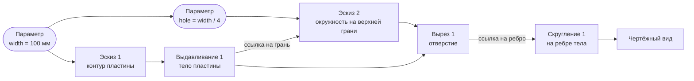
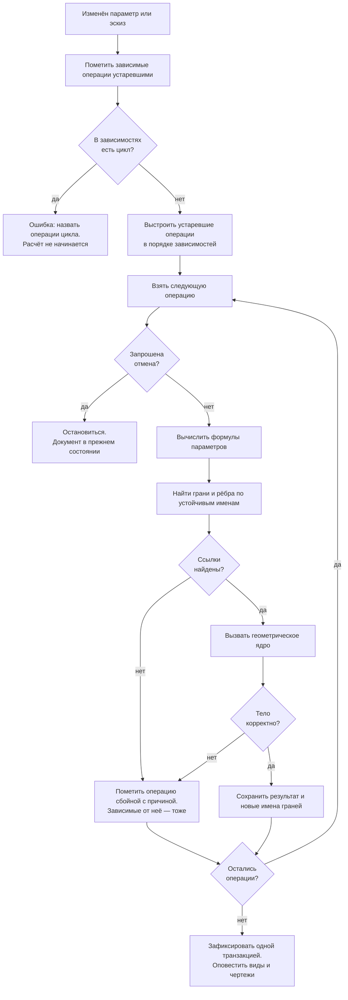

# Схема 3. Зависимости в 3D-модели и её перестроение

> **Состояние (версия 0.2).** Перестроение сделано: `modeling/recompute`. Схема ниже описывает
> замысел; в коде он упрощён. Операции выполняются по порядку дерева, а не по графу зависимостей;
> «пересчитывать только изменившееся» достигается отпечатком исходных данных каждой операции
> и всех предыдущих: совпал отпечаток — берётся готовый результат. Эскизы задаются фигурами
> с формулами, решателя ограничений нет.

## Что от чего зависит

Деталь хранится как список операций. Каждая операция зависит от параметров и от результатов
предыдущих операций. Пример: пластина с отверстием и скруглением.

Подписи «ссылка на грань» и «ссылка на ребро» — самое трудное место всей системы: после
пересчёта тело создаётся заново, и программа должна найти в нём «ту же самую» грань
(требование 3D-11, риск РЕШ-3).

## Как идёт перестроение

## Требования, которые здесь выполняются

| Требование | Где на схеме |
| --- | --- |
| Пересчитывается только зависимое (3D-9) | «Пометить зависимые операции устаревшими» |
| Циклы обнаруживаются до расчёта (3D-10) | Первая развилка |
| Сбой одной операции не ломает всю модель (3D-10) | «Пометить операцию сбойной с причиной» |
| Некорректное тело не попадает в документ (КАЧ-4) | Развилка «Тело корректно?» |
| Длительную операцию можно отменить (КАЧ-7) | Развилка «Запрошена отмена?» |
| Одинаковый вход — одинаковый результат (3D-9) | Порядок операций определяется только зависимостями |
