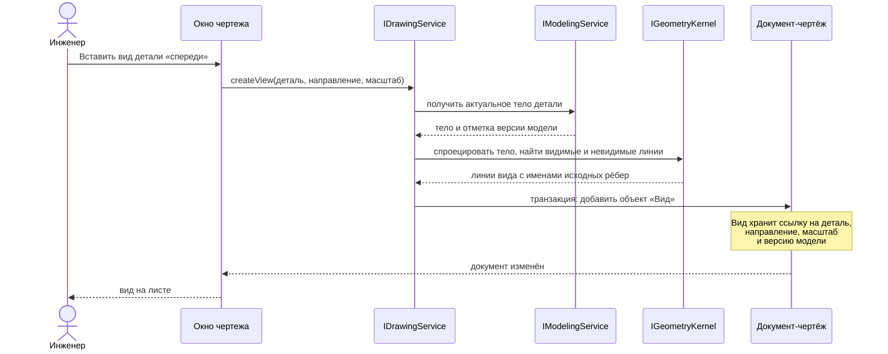
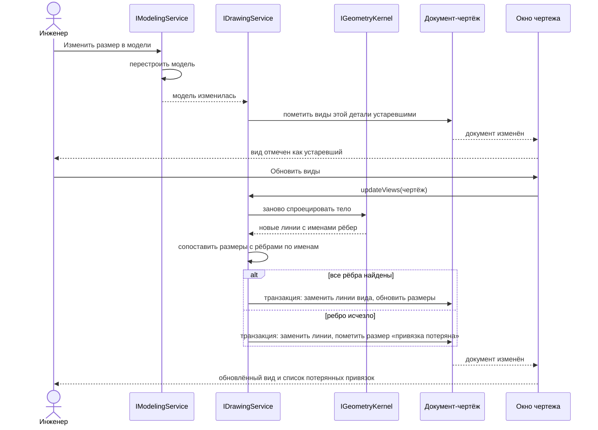

# Схема 4. Создание и обновление чертёжного вида по 3D-модели

> **Это проект, а не описание готового кода.** Виды по 3D-модели относятся к этапу 7 плана.
> **Состояние (версия 0.2).** Сделаны основные виды по модели и их обновление по команде
> (`drawing/src/ModelViews.cpp`, `apps/common/AppContext3D.cpp`). Привязки размеров к рёбрам,
> пометки «устарел» и разрезов из этой схемы пока нет.

## Создание вида

## Обновление вида после изменения модели

## Почему так

- **Вид не обновляется сам, пока инженер не попросит.** Перестроение больших сборок занимает
  время, а чертёж часто открыт просто для просмотра. Устаревший вид помечается явно.
- **Потерянная привязка показывается, а не скрывается** (требование ЧЕР-6). Размер, который
  молча «перепрыгнул» на другое ребро, — ошибка в изделии.
- **Обновление вида — одна транзакция**, его можно отменить одним шагом.
