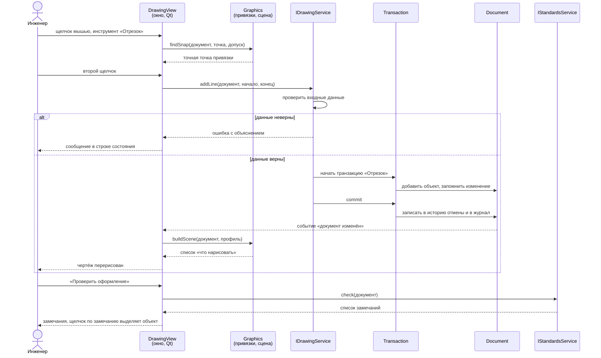
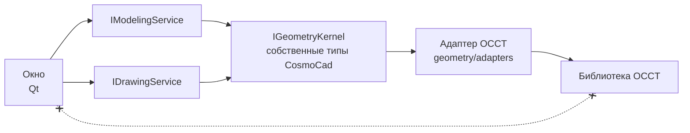

# Схема 5. Как общаются окно, сервисы и геометрическое ядро

## Как это работает сейчас: инженер рисует отрезок и проверяет оформление

Схема описывает готовый код 2D-цепочки. Для 3D путь тот же: окно 3D → `IModelingService` →
`IGeometryKernel` (адаптер OCCT) → тело → сетка → показ.

## Чего окно не делает

Окно (`ui/`) не знает правил оформления, не считает геометрию и не пишет в документ напрямую.
Всё это делают сервисы. Это требование исходного ТЗ («не смешивать UI, бизнес-логику, геометрию
и хранение данных»), и оно проверяется автоматически: Qt нельзя подключать нигде, кроме `ui/`
и `apps/cosmocad/`.

## Как подключится 3D-ядро (этап 6)

Перечёркнутая пунктирная линия — запрет: окно никогда не обращается к OCCT напрямую.
Заголовки OCCT разрешено подключать только в каталоге `geometry/adapters`. Благодаря этому
ядро можно заменить (например, на коммерческое), не трогая окна и модель данных.
