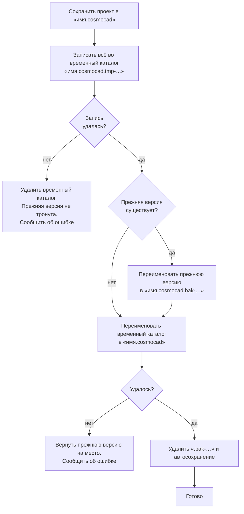
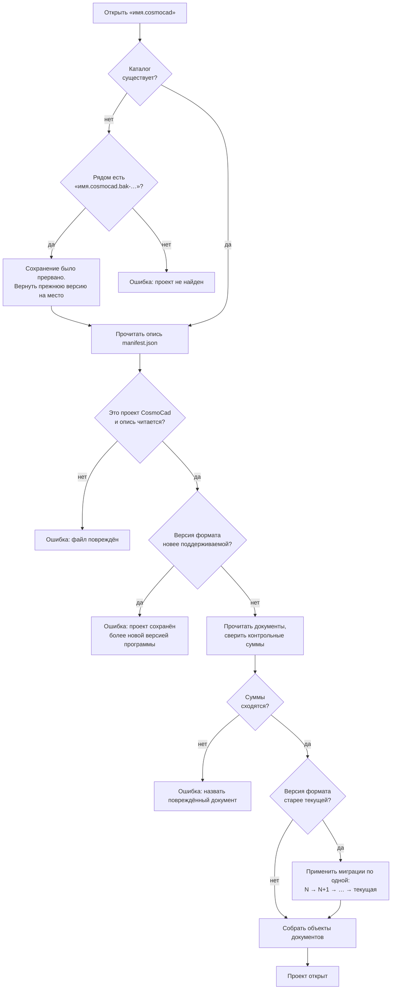
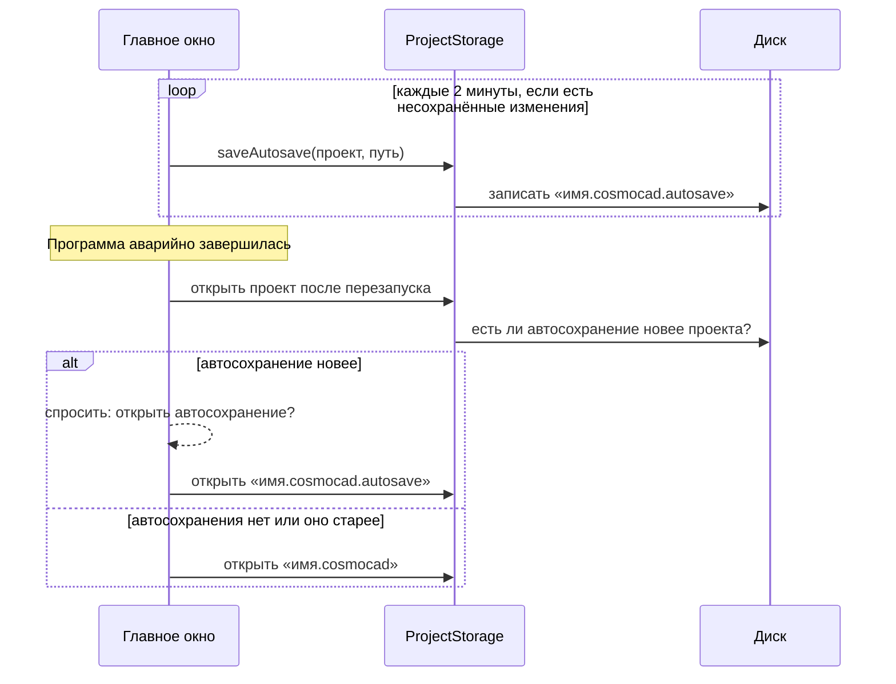

# Схема 6. Сохранение и восстановление проекта

Схемы описывают готовый код: `storage/src/ProjectStorage.cpp`. Каждая ветка покрыта тестом
в `tests/unit/test_exchange_storage.cpp`.

## Сохранение

Правило: прежняя версия проекта остаётся целой до тех пор, пока новая не записана полностью.

## Открытие

## Восстановление после аварийного завершения

После сбоя теряется не больше одного интервала автосохранения (требование ПЛ-10).
Обычное сохранение удаляет автосохранение.
