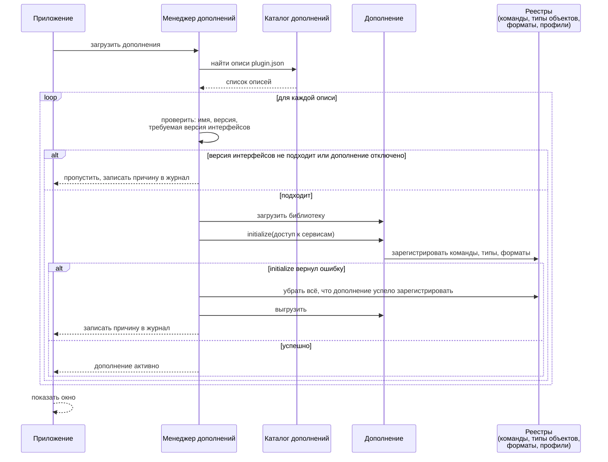
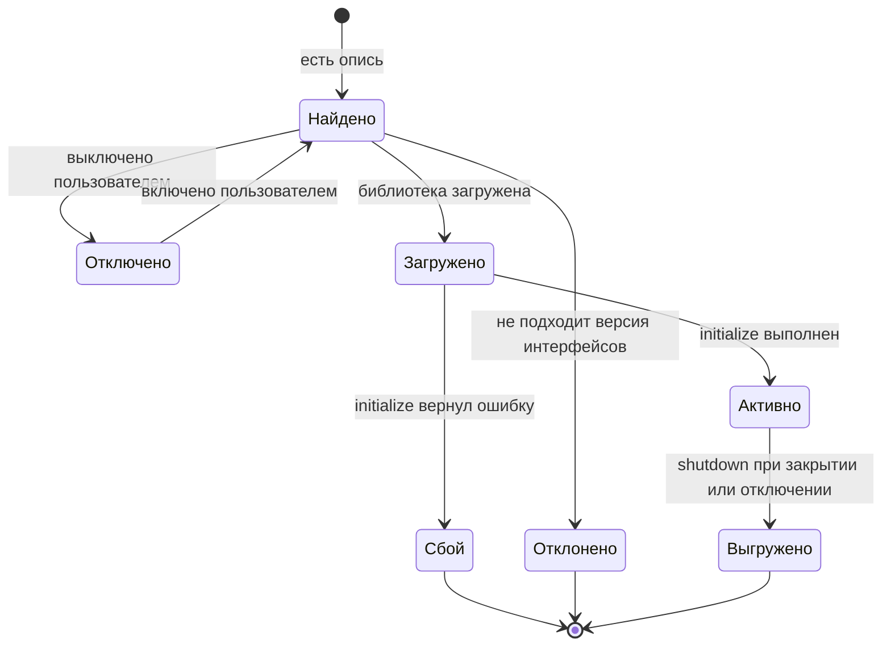

# Схема 7. Дополнения (плагины) и загрузка модулей

> С версии 0.16 это работает: `apps/common/Plugins.h`, пример — `plugins/mass-report`, описание для
> авторов дополнений — `docs/plugins.md`. Пока дополнение может добавлять только команды.

## Что такое дополнение

Дополнение — отдельная библиотека с описью. Оно получает доступ только к опубликованным
интерфейсам (`IDocumentService`, `IDrawingService`, `IStandardsService` и другим) и может
добавить команды, типы объектов, форматы обмена и профили стандартов.

Так же будут подключаться крупные модули CAE, CAM и PDM: они не входят в основную программу
и не усложняют её.

## Загрузка при запуске

## Состояния дополнения

## Правила

1. **Сбой дополнения не должен ронять программу.** Ошибка при загрузке — запись в журнал
   и работа без этого дополнения.
2. **Версии интерфейсов объявлены явно.** У каждого интерфейса есть номер версии
   (например, `kDrawingServiceApiVersion`). Дополнение указывает, для какой версии оно собрано.
3. **Документ с объектами отсутствующего дополнения должен открываться.** Неизвестные объекты
   сохраняются как есть и не теряются при записи (`UnknownObject`).
4. **Никаких дополнений с ИИ.** Запрет из исходного ТЗ распространяется и на дополнения,
   поставляемые вместе с программой.
